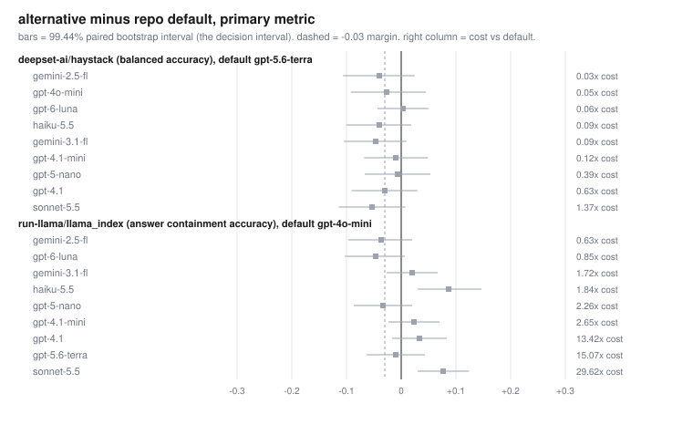
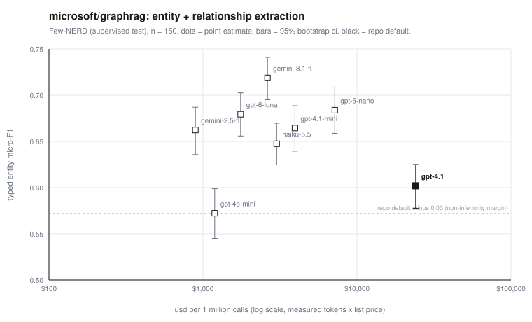
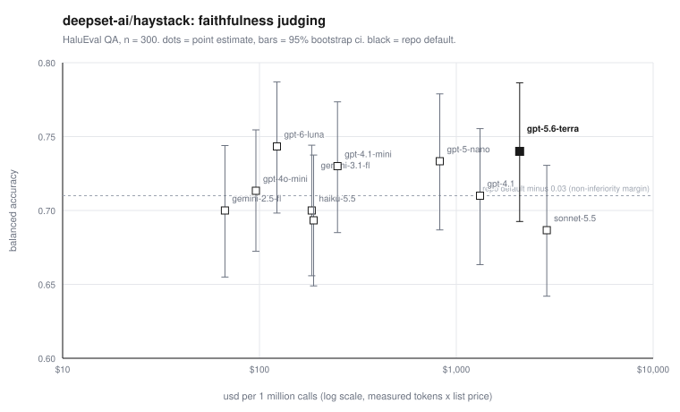
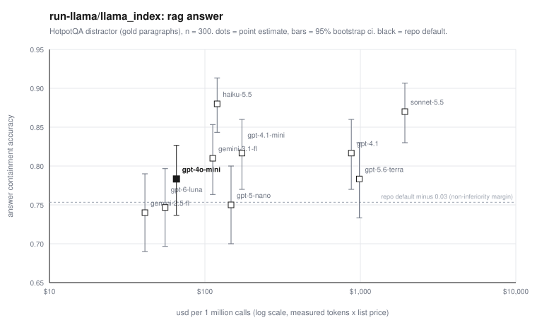

# is your default model actually the right one? i checked three famous repos

ronniel gandhe. draft, november 2026.

## tl;dr

- **graphrag picked wrong for this job.** at commit `34b2b67` it defaults to `gpt-4.1` for entity extraction. on Few-NERD (150 documents), 6 of the 7 cheaper models on my ladder beat it outright, whole 99.44% interval above zero. same provider, `gpt-6-luna`: +7.7 F1 points (+5.3 to +10.5) at 7% of the cost, $1,755 vs $24,049 per million documents. `gemini-3.1-flash-lite`: +11.7 points at 11%.
- **haystack picked fine.** its faithfulness judge defaults to `gpt-5.6-terra`, which came second of ten and nothing cheaper cleared the bar. `gpt-6-luna` tied it at 6% of the cost, but the interval is too wide to call it.
- **llamaindex's cheap default is fine.** `gpt-4o-mini` for rag answers: the only two cheaper models were worse.
- **bonus:** llamaindex's plain `OpenAI` class still defaults to `gpt-3.5-turbo`, which openai shut down. zero-config users get a 404.
- total api spend for everything, pilots included: 12.81 usd. every number has a saved raw output behind it and the rules were committed before the runs.

## the question

every llm framework ships a default model. most people never change it. so the default is, quietly, a pricing decision for a lot of teams who never made it.

so here's the question i wanted answered: take a call site where a well known repo hard-codes a model for one specific job. figure out what the job actually is. then run that exact job, with the repo's exact prompt, on public data that has real answers, across a ladder of models from three providers. is the default the right pick, or is something way cheaper just as good?

"right pick" needs a rule, not vibes. so before running anything i wrote the rule down and committed it (`PREREGISTRATION.md`, commit `cd5234e`): an alternative only beats the default if it is non-inferior on the dataset's own metric (99.44% paired bootstrap interval stays above minus 3 points) AND it costs at most half as much per call, measured from real token counts. if nothing clears that bar, the default is defensible and i say so.

## what leanfetch does here

leanfetch already scans a repo and flags where the llm bill leaks: calls in loops, no output cap, no caching, big models on small jobs. it's static analysis, no model involved. the weak spot was "big model on a small job": it guessed the job from keywords.

for this i added a small step in `research/callsites/`:

1. `extract.ts` reuses leanfetch's own parser (`lib/analyze/source.ts`, `lib/analyze/structure.ts`) and walks a checkout. it pulls three things, deterministically: llm call sites (leanfetch's existing detectors), model defaults (any assignment or kwarg default whose value is a model id, with file and line), and prompt templates (long string constants that read like prompts, with their placeholders).
2. `classify.py` sends each template to `claude-haiku-5-5` once, cached, and asks for one label from a fixed list (classification, extraction, summarization, query rewriting, rag answer, code generation, tool selection, grading/judging, reranking, chat, other), plus a public benchmark with the same shape and its metric. that's the only model in the scan, and it only classifies.

on the five repos i scanned it found 50 model defaults and 67 prompt templates for under two cents (`results/callsites/`). it correctly tagged graphrag's `GRAPH_EXTRACTION_PROMPT` as structured extraction with an entity-F1 benchmark analogue. two honest gaps: it can't always tell which default model runs which template (that link goes through config objects and constructors), and it misses prompts that are assembled in code, like haystack's evaluator prompt. for the three targets below i traced that link by hand and wrote down file and line.

## the targets

i wanted defaults that a lot of people inherit, a job that maps cleanly onto a public dataset, and a permissive license. three made the cut:

| | repo @ commit | default | where | job |
|---|---|---|---|---|
| T1 | microsoft/graphrag (36.7k stars, MIT) @ `34b2b67` | `gpt-4.1` | `packages/graphrag/graphrag/config/defaults.py:33`, used by `index/operations/extract_graph/graph_extractor.py` with `prompts/index/extract_graph.py` | pull entities and relationships out of text into graphrag's delimited format |
| T2 | deepset-ai/haystack (27.1k stars, Apache-2.0) @ `85b8d4e` | `gpt-5.6-terra` | `components/generators/chat/openai.py:135`, reached from `components/evaluators/llm_evaluator.py:114` when `FaithfulnessEvaluator()` gets no generator | faithfulness judge: split an answer into statements, score each 0/1 against the context |
| T3 | run-llama/llama_index (53.0k stars, MIT) @ `99d7433` | `gpt-4o-mini` | `llama-index-llms-openai/llama_index/llms/openai/responses.py:105` with the core `CHAT_TEXT_QA_PROMPT` | answer a question from retrieved context |

when were these lines last touched (github blame at those commits): graphrag's `gpt-4.1` default on 2026-01-27 (the v3 rewrite), haystack's `gpt-5.6-terra` on 2026-10-26 (a deliberate move to that model), llamaindex's `gpt-4o-mini` responses default on 2025-03-28. so two of these are recent, deliberate choices. that matters for how you read the results.

bonus finding, no benchmark needed: llamaindex's plain `OpenAI` class still defaults to `gpt-3.5-turbo` (`llama-index-llms-openai/llama_index/llms/openai/base.py:99`, last changed 2023-11-15), and that's what `Settings.llm` resolves to if you configure nothing. openai's model page says gpt-3.5-turbo was shut down on 2026-10-23, and a live call on 2026-11-22 returned `404 The model gpt-3.5-turbo has been deprecated` (`results/defaults_alive.json`). same for `gpt-3.5-turbo-16k`, the default in `core/postprocessor/rankGPT_rerank.py:20`. so the zero-config path errors on the first call. that's not a cost leak, it's a dead default, and it's a one-line fix.

## the method, plainly

- **same prompt, same structure.** prompts are read at run time out of the pinned checkouts with python's `ast`, not retyped (`lib/prompts.py`). graphrag gets its real two-request flow (extract, then one "MANY entities were missed" continuation, because `max_gleanings` defaults to 1) and its real parser. haystack's prompt is rebuilt with its own template logic and rendered with jinja2 like its `PromptBuilder`, and parsed with its strict `json.loads` rule. llamaindex gets its system + user chat messages and its 0.1 temperature where the api accepts it.
- **public data with real answers.** T1: Few-NERD supervised test (CC BY-SA 4.0), 6 shuffled sentences per document, gold person/organization/location/event spans. T2: HaluEval QA (MIT), half right answers, half hallucinated ones, against the given knowledge. T3: HotpotQA distractor dev (CC BY-SA 4.0) with the two gold paragraphs as the "retrieved" context. all samples are seeded (20261122) and the pilot items are kept out of the main sample.
- **ten models, three providers, every price tier.** gpt-4.1, gpt-5.6-terra, gpt-4.1-mini, gpt-4o-mini, gpt-6-luna, gpt-5-nano, claude-sonnet-5-5, claude-haiku-5-5, gemini-3.1-flash-lite, gemini-2.5-flash-lite. provider defaults for reasoning effort, because that's what you get when you only swap the model string. reasoning tokens are billed as output and they're counted.
- **the dataset's own metric, no llm judge.** T1 typed entity micro-F1. T2 balanced accuracy of haystack's faithful/unfaithful call (score >= 0.5). T3 answer containment.
- **real cost.** measured input and output tokens times list price (checked on the provider pages on 2026-11-22), reported per million calls.
- **stats.** paired bootstrap over items, 10,000 resamples. 95% intervals for reading, 99.44% (bonferroni for 9 comparisons) for decisions, exact mcnemar on the binary ones.

## results

three targets, three different answers. that's the honest headline: one default is clearly the wrong pick for its job, one is a defensible pick with a cheap model sitting right on its shoulder, and one is a cheap default that's fine. all numbers below come from `results/t1_main.json`, `results/t2_main.json` and `results/t3_main.json`.



### T1: graphrag's entity extraction (default gpt-4.1)



Few-NERD, n = 150 documents of 6 sentences, each run through graphrag's full default flow (extract + one gleaning pass). primary metric typed entity micro-F1. "usd per 1M calls" here means per million documents, both requests included.

| model | typed F1 [95% ci] | diff vs default [99.44% ci] | untyped F1 | usd per 1M calls | cost vs default | in / out tokens | verdict |
|---|---|---|---|---|---|---|---|
| gemini-2.5-flash-lite | 0.662 [0.636, 0.687] | +0.060 [+0.030, +0.090] | 0.707 | $893 | 0.04x | 4,499 / 1,107 | strictly better + cheaper |
| gpt-4o-mini | 0.572 [0.545, 0.599] | -0.030 [-0.062, +0.003] | 0.616 | $1,192 | 0.05x | 4,502 / 862 | not shown non-inferior |
| gpt-6-luna | 0.679 [0.656, 0.703] | +0.077 [+0.053, +0.105] | 0.719 | $1,755 | 0.07x | 4,769 / 2,557 | strictly better + cheaper |
| gemini-3.1-flash-lite | 0.719 [0.695, 0.741] | +0.117 [+0.091, +0.143] | 0.769 | $2,625 | 0.11x | 4,404 / 1,016 | strictly better + cheaper |
| claude-haiku-5-5 | 0.648 [0.625, 0.670] | +0.046 [+0.021, +0.072] | 0.688 | $3,009 | 0.13x | 7,699 / 4,479 | strictly better + cheaper |
| gpt-4.1-mini | 0.665 [0.640, 0.689] | +0.063 [+0.038, +0.089] | 0.712 | $3,955 | 0.16x | 4,719 / 1,292 | strictly better + cheaper |
| gpt-5-nano | 0.684 [0.659, 0.709] | +0.082 [+0.049, +0.114] | 0.728 | $7,174 | 0.30x | 4,718 / 17,346 | strictly better + cheaper |
| **gpt-4.1 (default)** | 0.602 [0.578, 0.625] | - | 0.649 | $24,049 | 1x | 5,027 / 1,749 | default |

verdict by the preregistered rule: **the default is the wrong pick for this job on this data.** 6 cheaper models clear the bar, and they don't just tie, they're strictly better: every one of them has its whole 99.44% interval above zero.

the cleanest line: at commit `34b2b67`, `packages/graphrag/graphrag/config/defaults.py:33` defaults graphrag to `gpt-4.1` for entity extraction; on Few-NERD, `gemini-3.1-flash-lite` beat it by 11.7 F1 points (99.44% ci +9.1 to +14.3) at 0.11x the cost, and `gpt-6-luna`, same provider, beat it by 7.7 points (ci +5.3 to +10.5) at 0.07x. in money: gpt-4.1 costs $24,049 per million documents through the default flow, gpt-6-luna $1,755. that's about $22,300 saved per million documents, while getting more of the entities right.

where does gpt-4.1 lose? not recall. it finds 76.3% of the gold entities, same as gpt-6-luna (76.6%) and gemini-3.1-flash-lite (75.1%). it loses on precision: 0.497, the lowest of the ladder. it extracts things that aren't there or aren't entities of those types ("DENMARK" from a sentence that says "Danish", years tagged as EVENT, "MARGIN ACCOUNT" as an ORGANIZATION). some of those might be useful graph nodes for some users. Few-NERD says they're wrong, and the cheaper models produce fewer of them.

the gleaning pass explains a lot of it (exploratory, not preregistered, `results/t1_exploratory_gleaning.json`). graphrag's second request tells the model "MANY entities and relationships were missed in the last extraction". gpt-4.1 believes it and adds 5.6 entities per document, and its F1 drops 8.5 points (first request alone: 0.687; with the gleaning: 0.602; 95% ci of the drop 7.3 to 9.7). claude-haiku-5-5 drops 7.0. gemini-3.1-flash-lite and gpt-4o-mini barely move. for every model i ran, dropping the gleaning pass roughly halves the cost and the F1 either goes up or stays inside noise. so the full fix might be two lines, not one. even with gleaning off, gpt-4.1 (0.687) stays below gemini-3.1-flash-lite with gleaning on (0.719).

the obvious pushback is "Few-NERD just didn't label everything", and that's partly true: some of gpt-4.1's "false" entities, like Stockholm in "Bo Tarras-Wahlberg, of Stockholm", really are in the text. so i ran a sensitivity check that's deliberately generous to models that extract more (exploratory, `results/t1_exploratory_unlabelled.json`): any predicted name that isn't gold but appears verbatim in the source is ignored instead of counted wrong. gpt-4.1 benefits most from that (4.9 ignored per document vs 2.0 to 3.1 for the others) and climbs to 0.732. gemini-3.1-flash-lite is still ahead by 6.3 points (99.44% ci +3.9 to +8.9) and gpt-6-luna by 3.5 (ci +1.0 to +6.2). gpt-4.1-mini, claude-haiku-5-5 and gemini-2.5-flash-lite drop to ties that still clear the non-inferiority bar. so even on the reading most favorable to the default, a model at a tenth of the price is at least as good.

checks: the verdict holds under the older name normalizer too (`sensitivity_normalizer_v1` in `results/t1_main.json`, every qualifying model still strictly better), and every qualifying model also beats it on untyped F1.

one model on the cheap end didn't make it: gpt-4o-mini lands 3.0 points under the default (99.44% ci -6.2 to +0.3), with the lowest recall of the ladder (0.522). cheap isn't automatically fine.

two ladder models are missing from this table: gpt-5.6-terra and claude-sonnet-5-5 didn't finish before i stopped the run (`DEVIATIONS.md` #10). neither could have qualified, since both cost more per document than gpt-4.1 (gpt-5.6-terra measured $37,782 per million documents on the 47 it finished, 1.57x the default).

### T2: haystack's faithfulness judge (default gpt-5.6-terra)



HaluEval QA, n = 300 (150 right answers, 150 hallucinated). primary metric balanced accuracy, faithful iff haystack's score >= 0.5. intervals: 95% on the model's own score, 99.44% on the paired difference vs the default.

| model | balanced acc [95% ci] | diff vs default [99.44% ci] | hallucinations caught | usd per 1M calls | cost vs default | in / out tokens | verdict |
|---|---|---|---|---|---|---|---|
| gemini-2.5-flash-lite | 0.700 [0.655, 0.744] | -0.040 [-0.106, +0.025] | 0.467 | $67 | 0.03x | 492 / 44 | not shown non-inferior |
| gpt-4o-mini | 0.713 [0.672, 0.755] | -0.027 [-0.092, +0.045] | 0.447 | $96 | 0.05x | 478 / 40 | not shown non-inferior |
| gpt-6-luna | 0.743 [0.698, 0.787] | +0.003 [-0.043, +0.050] | 0.553 | $123 | 0.06x | 477 / 150 | not shown non-inferior |
| claude-haiku-5-5 | 0.700 [0.656, 0.744] | -0.040 [-0.101, +0.018] | 0.467 | $184 | 0.09x | 1,025 / 163 | not shown non-inferior |
| gemini-3.1-flash-lite | 0.693 [0.649, 0.738] | -0.047 [-0.105, +0.009] | 0.447 | $188 | 0.09x | 492 / 44 | not shown non-inferior |
| gpt-4.1-mini | 0.730 [0.685, 0.774] | -0.010 [-0.068, +0.049] | 0.520 | $249 | 0.12x | 478 / 36 | not shown non-inferior |
| gpt-5-nano | 0.733 [0.687, 0.779] | -0.007 [-0.067, +0.053] | 0.553 | $824 | 0.39x | 477 / 2,000 | not shown non-inferior |
| gpt-4.1 | 0.710 [0.663, 0.755] | -0.030 [-0.091, +0.030] | 0.507 | $1,320 | 0.63x | 478 / 45 | not shown non-inferior |
| **gpt-5.6-terra (default)** | 0.740 [0.693, 0.786] | - | 0.587 | $2,098 | 1x | 477 / 95 | default |
| claude-sonnet-5-5 | 0.687 [0.642, 0.731] | -0.053 [-0.114, +0.008] | 0.440 | $2,881 | 1.37x | 1,025 / 83 | not shown non-inferior |

verdict by the preregistered rule: **defensible. nothing qualified.** the default had the second best score of the ten.

the interesting one is gpt-6-luna: same score to the third decimal (0.743 vs 0.740), 6% of the cost, and mcnemar can't tell them apart (13 vs 12 discordant items, p = 1.0). but its 99.44% interval goes down to -0.043, past the -0.03 margin. so at n = 300 i can't say it's non-inferior, and i won't. it's a strong "test this on your own data", not a verdict.

two more things this run showed:

- **every judge is weak at the actual job.** all ten models pass 89 to 98% of the right answers but only catch 44 to 59% of the hallucinated ones (`results/t2_main.json`, `faithful_recall` / `hallucination_recall`). that gap is the prompt and the threshold, not the model. exploratory and not preregistered: if you call an answer faithful only when every statement scores 1, every model gains 4 to 14 points (gpt-5.6-terra 0.740 -> 0.833, gpt-6-luna 0.743 -> 0.863; gpt-6-luna minus default = +0.030, 95% ci [0.000, +0.061]). if you run this evaluator, the threshold you pick moves the result more than the model does.
- **gpt-5.6-terra returned no statements for 9 of the 150 right answers** (bare answers like "Botswana" or "1937"). haystack scores that as 0, so those count as misses. gpt-5-nano returned `{"error": "No data provided..."}` on 8 of 300 items; it apparently read haystack's inline-json input as an empty template.

### T3: llamaindex's default rag answer (default gpt-4o-mini)



HotpotQA distractor dev, n = 300, the two gold paragraphs as context. primary metric answer containment.

| model | containment [95% ci] | diff vs default [99.44% ci] | token F1 | usd per 1M calls | cost vs default | in / out tokens | verdict |
|---|---|---|---|---|---|---|---|
| gemini-2.5-flash-lite | 0.757 [0.707, 0.803] | -0.037 [-0.097, +0.020] | 0.509 | $41 | 0.63x | 356 / 14 | not shown non-inferior |
| gpt-6-luna | 0.747 [0.697, 0.797] | -0.047 [-0.103, +0.007] | 0.590 | $55 | 0.85x | 342 / 43 | not shown non-inferior |
| **gpt-4o-mini (default)** | 0.793 [0.747, 0.837] | - | 0.249 | $65 | 1x | 343 / 23 | default |
| gemini-3.1-flash-lite | 0.813 [0.770, 0.857] | +0.020 [-0.027, +0.067] | 0.475 | $112 | 1.72x | 356 / 16 | non-inferior, not 2x cheaper |
| claude-haiku-5-5 | 0.880 [0.843, 0.913] | +0.087 [+0.030, +0.147] | 0.202 | $120 | 1.84x | 533 / 133 | non-inferior, not 2x cheaper |
| gpt-5-nano | 0.760 [0.713, 0.807] | -0.033 [-0.087, +0.020] | 0.697 | $148 | 2.26x | 342 / 326 | not shown non-inferior |
| gpt-4.1-mini | 0.817 [0.770, 0.860] | +0.023 [-0.023, +0.070] | 0.258 | $173 | 2.65x | 343 / 22 | non-inferior, not 2x cheaper |
| gpt-4.1 | 0.827 [0.783, 0.867] | +0.033 [-0.017, +0.083] | 0.281 | $876 | 13.42x | 343 / 24 | non-inferior, not 2x cheaper |
| gpt-5.6-terra | 0.783 [0.733, 0.830] | -0.010 [-0.063, +0.043] | 0.585 | $984 | 15.07x | 342 / 25 | not shown non-inferior |
| claude-sonnet-5-5 | 0.870 [0.830, 0.907] | +0.077 [+0.030, +0.124] | 0.146 | $1,935 | 29.62x | 533 / 87 | non-inferior, not 2x cheaper |

verdict: **defensible.** gpt-4o-mini is already the third cheapest model on the ladder, and the two cheaper ones score lower (neither clears the margin). the only models that clearly beat it cost more: claude-haiku-5-5 at 1.84x is +8.7 points (99.44% ci +3.0 to +14.7). so if anything the cheap default is leaving accuracy on the table, not money.

but read the token F1 column before you switch anything. containment and F1 basically disagree here: haiku and sonnet write longer answers (133 and 87 output tokens), which helps containment and hurts F1; gpt-5.6-terra and gpt-6-luna answer in a few words, which does the opposite. i preregistered containment, so the verdict stands on it, but T3 is the weakest of the three for drawing anything beyond "the default is fine".

## where the repos were right

- **haystack (T2).** gpt-5.6-terra was the second best judge of the ten on balanced accuracy and nothing cheaper cleared the bar. the line was changed on purpose a month before this snapshot (`fix!: move OpenAI chat generators to gpt-5.6-terra`, 2026-10-26), and on this job it holds up. the only caveat is gpt-6-luna tying it at 6% of the cost, which isn't enough to call, but is enough to test.
- **llamaindex responses default (T3).** gpt-4o-mini is near the bottom of the price ladder already and the only two cheaper models scored lower. if anything this default under-spends: claude-haiku-5-5 is +8.7 points for 1.8x the price. defaulting to a cheap model was the right call here.

## where it was wrong, and by how much

- **graphrag (T1).** gpt-4.1 at $24,049 per million documents, beaten on typed F1 by six of the seven cheaper models with the whole decision interval above zero. careful with the fix, though: `DEFAULT_COMPLETION_MODEL` feeds every llm step in graphrag (graph extraction, claims, description summaries, community reports, and all four search modes), and i only measured extraction. so the honest one-line fix is scoped to extraction. graphrag's `settings.yaml` already lets each step pick its own model, so it's one extra model entry plus one line:

  ```yaml
  completion_models:
    extract_model:
      model_provider: openai
      model: gpt-6-luna
  extract_graph:
    completion_model_id: extract_model
  ```

  on this data that takes extraction to $1,755 per million documents and +7.7 F1 points. a second line worth testing is `max_gleanings: 0` under `extract_graph`, which halves the cost again and, on this data, helps most models. whether gpt-6-luna is also fine for community reports or search is a separate question i didn't test.
- **llamaindex `OpenAI` default (not benchmarked).** `DEFAULT_OPENAI_MODEL = "gpt-3.5-turbo"` points at a model openai shut down on 2026-10-23. the fix is any live model id; given T3, `gpt-4o-mini` (the default the same package already uses for `OpenAIResponses`) is a sensible one.

none of this says anything about the maintainers. graphrag's default was set in a big v3 rewrite in january; picking a strong general model for a pipeline that has to work out of the box is a reasonable instinct. it just turns out the narrow job doesn't need it, and the second pass actively hurts it.

## threats to validity (read this before you quote me)

- **a dataset is a proxy.** nobody runs graphrag on six shuffled wikipedia sentences, or haystack's judge on hotpotqa-style trivia. Few-NERD, HaluEval and HotpotQA have the same shape as these jobs, not the same traffic. a model that ties on Few-NERD can still lose on your contracts or your support tickets. the claim is about this job on this data, nothing wider.
- **the labels are not perfect.** Few-NERD calls some things organizations that most people wouldn't (a "light photographic squadron"), and graphrag's own prompt calls a prison a GEO, which is why building/art/product/other spans are ignored instead of punished. HaluEval's right answers are short spans and its hallucinated answers are full sentences, so a judge can partly cheat off style. both quirks hit every model the same way, which is why the paired comparisons are the thing to trust, not the absolute numbers.
- **the metric shapes the winner on T3.** containment rewards longer answers (more chances to contain the gold string) and token F1 rewards short ones. on T3 those two metrics rank the models almost in opposite order. i preregistered containment as primary and i report the verdict on it, but i would not hang anything on T3 alone.
- **same prompt for everyone.** every model ran the repo's prompt unchanged. if a prompt was tuned for the default, that tilts things toward the default, which makes the graphrag "wrong pick" verdict conservative but means the two "defensible" verdicts could change if someone tuned a prompt for a cheaper model. i didn't test tuned prompts.
- **provider defaults for reasoning.** reasoning models ran at their default effort. lower effort would make gpt-5-nano, gpt-5.6-terra and the claude models cheaper (fewer output tokens), and maybe worse. i measured what you get by changing one string, not the best each model can do.
- **single run per item.** no repeated sampling. graphrag sends no temperature (so the provider default applies) and llamaindex sends 0.1 where the api allows it, so a rerun would move numbers a little. the bootstrap covers item sampling, not model sampling noise.
- **the T2 threshold is mine.** haystack returns a 0 to 1 score; turning it into faithful/unfaithful at 0.5 was my preregistered choice, not haystack's. the exploratory "every statement must score 1" rule changes every model's number by more than the gaps between models.
- **i fixed my own bugs mid-study.** a ledger race that made some requests fail, a name normalizer that didn't match the preregistered rule (fixed after provisional T1 numbers were visible, so both versions are reported and the verdict holds under both), haystack's empty-statement scoring, and two restarts of the graphrag run when the laptop slept. all logged with dates and effects in `DEVIATIONS.md`.
- **dates.** prices and model ids are a snapshot from 2026-11-22. the defaults were set at different times (graphrag's in jan 2026, haystack's in oct 2026, llamaindex's responses default in mar 2025). a default that was the sensible pick when it was written can look worse a year later. that's a maintenance point, not a judgment call about anyone.
- **small n.** 150 to 300 items per target. intervals are a few points wide. that's why the decision rule uses the wide 99.44% interval and a 3 point margin, and why "inconclusive" is a real outcome here.
- **budget and time forced cuts**, all logged in `DEVIATIONS.md`: the graphrag pilot shrank to 2 documents and the graphrag main sample to 150 documents (both decided before main results), and the two priciest models never finished graphrag (they couldn't have qualified, see T1).

## what it means if you ship llm calls

- **a framework-wide default is a decision made for every job at once.** graphrag's `gpt-4.1` is one model for extraction, claims, summaries, community reports and search; the extraction step just doesn't need it. haystack's judge default was picked recently and on purpose, and llamaindex's responses default was picked cheap; both held up. the gap showed up where a general default met a narrow job.
- **measure the job, not the price tag.** on all three targets, the most expensive model that finished wasn't the best one, and neither was the cheapest. a few hundred items of your own job with a real metric beats any leaderboard: the judge and rag targets cost me $2.57 and $1.44 for all ten models, and graphrag (long prompts, two requests per document) about $8.60.
- **count reasoning tokens.** gpt-5-nano lists at $0.05 / $0.40 per million and still cost more per call than gpt-4.1-mini on the judge job, because it wrote about 2,000 tokens of reasoning to output 40. list price is not the price.
- **the prompt and the plumbing can matter more than the model.** graphrag's "MANY entities were missed" second pass and haystack's score threshold each moved quality more than swapping models did. check those before you shop for a model.
- **write the bar down before you look.** i nearly published a wrong haystack result. a race in my own spend ledger made 29 of the default model's requests error out on my side, and with those counted as misses the default looked clearly beaten. the preregistration said failed calls get re-run once, so i re-ran them, and the default came out second best. without the rule i'd have had a nicer story and a false one.

## how to reproduce

everything is in `research/` on the `model-fit` branch of leanfetch.

```bash
cd research
export OPENAI_API_KEY=... ANTHROPIC_API_KEY=... GOOGLE_API_KEY=...
./run_all.sh
```

that runs, in order: pin and scan the repos (`stage1_targets.sh`, `callsites/extract.ts`, `callsites/classify.py`), check the default models still answer (`stage1b_defaults_alive.py`), build the seeded samples (`stage2_data.py`), replay every call (`stage3_run.py t3|t2|t1 main`), score and bootstrap (`stage4_analyze.py`), draw the charts (`stage5_charts.py`) and the appendix (`stage6_appendix.py`). `stage7_spend.py` re-adds the cost of every cached response as a check on `spend.json`.

every model response is cached under `cache/<stage>/<model>/<sha256 of the request>.json` with the request, the raw text, token counts, latency and cost, and it's committed. so rerunning the analysis costs nothing and gives the same numbers; deleting `cache/` and rerunning re-buys the data. requests are stored without any auth headers. the samples are seeded (20261122), the bootstrap is seeded (7).

the scan step works on any repo: `../node_modules/.bin/jiti callsites/extract.ts <checkout> out.json <label>`.

## appendix a: model ids and prices

prices checked against the live provider pages on 2026-11-22. usd per 1M tokens, standard tier, no caching, no batch.

| model id (requested) | served as | input | output |
|---|---|---|---|
| `gpt-4.1` | `gpt-4.1-2025-04-14` | $2.00 | $8.00 |
| `gpt-4.1-mini` | `gpt-4.1-mini-2025-04-14` | $0.40 | $1.60 |
| `gpt-4o-mini` | `gpt-4o-mini-2024-07-18` | $0.15 | $0.60 |
| `gpt-5.6-terra` | `gpt-5.6-terra` | $2.00 | $12.00 |
| `gpt-6-luna` | `gpt-6-luna` | $0.10 | $0.50 |
| `gpt-5-nano` | `gpt-5-nano-2025-08-07` | $0.05 | $0.40 |
| `claude-sonnet-5-5` | `claude-sonnet-5-5` | $2.00 | $10.00 |
| `claude-haiku-5-5` | `claude-haiku-5-5` | $0.10 | $0.50 |
| `gemini-3.1-flash-lite` | `gemini-3.1-flash-lite` | $0.25 | $1.50 |
| `gemini-2.5-flash-lite` | `gemini-2.5-flash-lite` | $0.10 | $0.40 |

sources: anthropic: https://platform.claude.com/docs/en/about-claude/pricing, openai: https://developers.openai.com/api/docs/pricing, google: https://aistudio.google.com/docs/pricing (redirect from ai.google.dev/gemini-api/docs/pricing), openai_gpt35: https://developers.openai.com/api/docs/models/gpt-3.5-turbo

## appendix b: target commits

| repo | commit | url |
|---|---|---|
| graphrag | `34b2b67ae4601ad0b47bcd179fbe3f2a23aa0857` | https://github.com/microsoft/graphrag |
| haystack | `85b8d4e0b8332a60002c3e06972386476fba6b7a` | https://github.com/deepset-ai/haystack |
| llama_index | `99d7433f6f71888951379ccca9294e272442c832` | https://github.com/run-llama/llama_index |
| deepeval | `aeb529e8b79cae158c8f1033b7b4360127ced585` | https://github.com/confident-ai/deepeval |
| mem0 | `fff8a6472512d1bc1a4bccab8c645b65a1df7fe5` | https://github.com/mem0ai/mem0 |

default-model liveness check (`results/defaults_alive.json`):

| repo | line | model | result |
|---|---|---|---|
| graphrag | `packages/graphrag/graphrag/config/defaults.py:33` | `gpt-4.1` | ok |
| haystack | `haystack/components/generators/chat/openai.py:135` | `gpt-5.6-terra` | ok |
| llama_index | `llama-index-llms-openai/llama_index/llms/openai/responses.py:105` | `gpt-4o-mini` | ok |
| llama_index | `llama-index-llms-openai/llama_index/llms/openai/base.py:99` | `gpt-3.5-turbo` | error: Error code: 404 - The model `gpt-3.5-turbo` has been deprecated, learn more here: https:// |
| llama_index | `llama-index-core/llama_index/core/postprocessor/rankGPT_rerank.py:20` | `gpt-3.5-turbo-16k` | error: Error code: 404 - The model `gpt-3.5-turbo-16k` has been deprecated, learn more here: http |

## appendix c: exact prompts

pulled at run time from the pinned checkouts with `ast` (see `lib/prompts.py`), so these are byte-for-byte the repo strings.

### T1 graphrag `GRAPH_EXTRACTION_PROMPT` (first request; `{entity_types}` = `organization,person,geo,event`)

```text

-Goal-
Given a text document that is potentially relevant to this activity and a list of entity types, identify all entities of those types from the text and all relationships among the identified entities.
 
-Steps-
1. Identify all entities. For each identified entity, extract the following information:
- entity_name: Name of the entity, capitalized
- entity_type: One of the following types: [{entity_types}]
- entity_description: Comprehensive description of the entity's attributes and activities
Format each entity as ("entity"<|><entity_name><|><entity_type><|><entity_description>)
 
2. From the entities identified in step 1, identify all pairs of (source_entity, target_entity) that are *clearly related* to each other.
For each pair of related entities, extract the following information:
- source_entity: name of the source entity, as identified in step 1
- target_entity: name of the target entity, as identified in step 1
- relationship_description: explanation as to why you think the source entity and the target entity are related to each other
- relationship_strength: a numeric score indicating strength of the relationship between the source entity and target entity
 Format each relationship as ("relationship"<|><source_entity><|><target_entity><|><relationship_description><|><relationship_strength>)
 
3. Return output in English as a single list of all the entities and relationships identified in steps 1 and 2. Use **##** as the list delimiter.
 
4. When finished, output <|COMPLETE|>
 
######################
-Examples-
######################
Example 1:
Entity_types: ORGANIZATION,PERSON
Text:
The Verdantis's Central Institution is scheduled to meet on Monday and Thursday, with the institution planning to release its latest policy decision on Thursday at 1:30 p.m. PDT, followed by a press conference where Central Institution Chair Martin Smith will take questions. Investors expect the Market Strategy Committee to hold its benchmark interest rate steady in a range of 3.5%-3.75%.
######################
Output:
("entity"<|>CENTRAL INSTITUTION<|>ORGANIZATION<|>The Central Institution is the Federal Reserve of Verdantis, which is setting interest rates on Monday and Thursday)
##
("entity"<|>MARTIN SMITH<|>PERSON<|>Martin Smith is the chair of the Central Institution)
##
("entity"<|>MARKET STRATEGY COMMITTEE<|>ORGANIZATION<|>The Central Institution committee makes key decisions about interest rates and the growth of Verdantis's money supply)
##
("relationship"<|>MARTIN SMITH<|>CENTRAL INSTITUTION<|>Martin Smith is the Chair of the Central Institution and will answer questions at a press conference<|>9)
<|COMPLETE|>

######################
Example 2:
Entity_types: ORGANIZATION
Text:
TechGlobal's (TG) stock skyrocketed in its opening day on the Global Exchange Thursday. But IPO experts warn that the semiconductor corporation's debut on the public markets isn't indicative of how other newly listed companies may perform.

TechGlobal, a formerly public company, was taken private by Vision Holdings in 2014. The well-established chip designer says it powers 85% of premium smartphones.
######################
Output:
("entity"<|>TECHGLOBAL<|>ORGANIZATION<|>TechGlobal is a stock now listed on the Global Exchange which powers 85% of premium smartphones)
##
("entity"<|>VISION HOLDINGS<|>ORGANIZATION<|>Vision Holdings is a firm that previously owned TechGlobal)
##
("relationship"<|>TECHGLOBAL<|>VISION HOLDINGS<|>Vision Holdings formerly owned TechGlobal from 2014 until present<|>5)
<|COMPLETE|>

######################
Example 3:
Entity_types: ORGANIZATION,GEO,PERSON
Text:
Five Aurelians jailed for 8 years in Firuzabad and widely regarded as hostages are on their way home to Aurelia.

The swap orchestrated by Quintara was finalized when $8bn of Firuzi funds were transferred to financial institutions in Krohaara, the capital of Quintara.

The exchange initiated in Firuzabad's capital, Tiruzia, led to the four men and one woman, who are also Firuzi nationals, boarding a chartered flight to Krohaara.

They were welcomed by senior Aurelian officials and are now on their way to Aurelia's capital, Cashion.

The Aurelians include 39-year-old businessman Samuel Namara, who has been held in Tiruzia's Alhamia Prison, as well as journalist Durke Bataglani, 59, and environmentalist Meggie Tazbah, 53, who also holds Bratinas nationality.
######################
Output:
("entity"<|>FIRUZABAD<|>GEO<|>Firuzabad held Aurelians as hostages)
##
("entity"<|>AURELIA<|>GEO<|>Country seeking to release hostages)
##
("entity"<|>QUINTARA<|>GEO<|>Country that negotiated a swap of money in exchange for hostages)
##
##
("entity"<|>TIRUZIA<|>GEO<|>Capital of Firuzabad where the Aurelians were being held)
##
("entity"<|>KROHAARA<|>GEO<|>Capital city in Quintara)
##
("entity"<|>CASHION<|>GEO<|>Capital city in Aurelia)
##
("entity"<|>SAMUEL NAMARA<|>PERSON<|>Aurelian who spent time in Tiruzia's Alhamia Prison)
##
("entity"<|>ALHAMIA PRISON<|>GEO<|>Prison in Tiruzia)
##
("entity"<|>DURKE BATAGLANI<|>PERSON<|>Aurelian journalist who was held hostage)
##
("entity"<|>MEGGIE TAZBAH<|>PERSON<|>Bratinas national and environmentalist who was held hostage)
##
("relationship"<|>FIRUZABAD<|>AURELIA<|>Firuzabad negotiated a hostage exchange with Aurelia<|>2)
##
("relationship"<|>QUINTARA<|>AURELIA<|>Quintara brokered the hostage exchange between Firuzabad and Aurelia<|>2)
##
("relationship"<|>QUINTARA<|>FIRUZABAD<|>Quintara brokered the hostage exchange between Firuzabad and Aurelia<|>2)
##
("relationship"<|>SAMUEL NAMARA<|>ALHAMIA PRISON<|>Samuel Namara was a prisoner at Alhamia prison<|>8)
##
("relationship"<|>SAMUEL NAMARA<|>MEGGIE TAZBAH<|>Samuel Namara and Meggie Tazbah were exchanged in the same hostage release<|>2)
##
("relationship"<|>SAMUEL NAMARA<|>DURKE BATAGLANI<|>Samuel Namara and Durke Bataglani were exchanged in the same hostage release<|>2)
##
("relationship"<|>MEGGIE TAZBAH<|>DURKE BATAGLANI<|>Meggie Tazbah and Durke Bataglani were exchanged in the same hostage release<|>2)
##
("relationship"<|>SAMUEL NAMARA<|>FIRUZABAD<|>Samuel Namara was a hostage in Firuzabad<|>2)
##
("relationship"<|>MEGGIE TAZBAH<|>FIRUZABAD<|>Meggie Tazbah was a hostage in Firuzabad<|>2)
##
("relationship"<|>DURKE BATAGLANI<|>FIRUZABAD<|>Durke Bataglani was a hostage in Firuzabad<|>2)
<|COMPLETE|>

######################
-Real Data-
######################
Entity_types: {entity_types}
Text: {input_text}
######################
Output:
```

### T1 graphrag `CONTINUE_PROMPT` (second request, after the model's first answer)

```text
MANY entities and relationships were missed in the last extraction. Remember to ONLY emit entities that match any of the previously extracted types. Add them below using the same format:
```

### T2 haystack faithfulness template (jinja2, rendered like haystack's PromptBuilder)

```text
Instructions:
Your task is to judge the faithfulness or groundedness of statements based on context information. First, please extract statements from a provided predicted answer to a question. Second, calculate a faithfulness score for each statement made in the predicted answer. The score is 1 if the statement can be inferred from the provided context or 0 if it cannot be inferred.

Generate the response in JSON format with the following keys:
["statements", "statement_scores"]
Consider the instructions and the examples below to determine those values.

Examples:
Inputs:
{"questions": "What is the capital of Germany and when was it founded?", "contexts": ["Berlin is the capital of Germany and was founded in 1244."], "predicted_answers": "The capital of Germany, Berlin, was founded in the 13th century."}
Outputs:
{"statements": ["Berlin is the capital of Germany.", "Berlin was founded in 1244."], "statement_scores": [1, 1]}
Inputs:
{"questions": "What is the capital of France?", "contexts": ["Berlin is the capital of Germany."], "predicted_answers": "Paris"}
Outputs:
{"statements": ["Paris is the capital of France."], "statement_scores": [0]}
Inputs:
{"questions": "What is the capital of Italy?", "contexts": ["Rome is the capital of Italy."], "predicted_answers": "Rome is the capital of Italy with more than 4 million inhabitants."}
Outputs:
{"statements": ["Rome is the capital of Italy.", "Rome has more than 4 million inhabitants."], "statement_scores": [1, 0]}

Inputs:
{"questions": {{ questions }}, "contexts": {{ contexts }}, "predicted_answers": {{ predicted_answers }}}
Outputs:
```

### T3 llamaindex `CHAT_TEXT_QA_PROMPT` system message

```text
You are an expert Q&A system that is trusted around the world.
Always answer the query using the provided context information, and not prior knowledge.
Some rules to follow:
1. Never directly reference the given context in your answer.
2. Avoid statements like 'Based on the context, ...' or 'The context information ...' or anything along those lines.
```

### T3 llamaindex `CHAT_TEXT_QA_PROMPT` user message

```text
Context information is below.
---------------------
{context_str}
---------------------
Given the context information and not prior knowledge, answer the query.
Query: {query_str}
Answer: 
```
