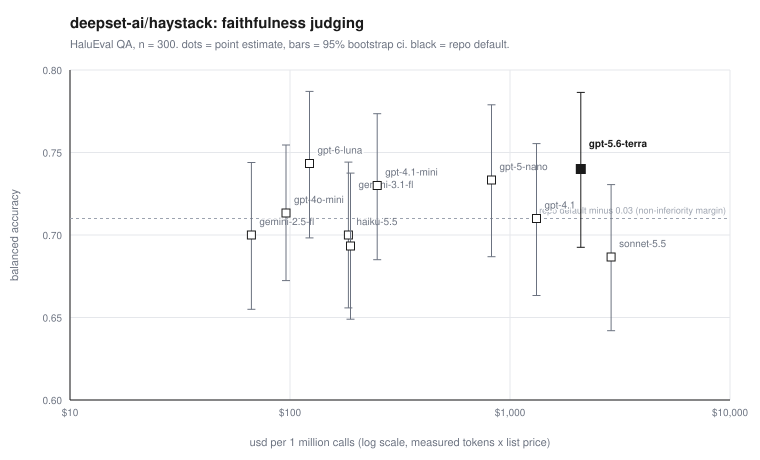
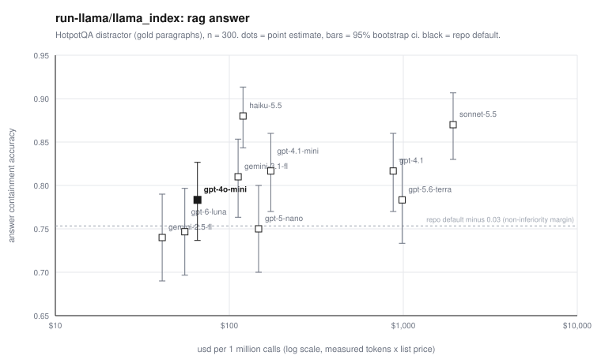

### T2: haystack's faithfulness judge (default gpt-5.6-terra)

HaluEval QA, n = 300 (150 right answers, 150 hallucinated). primary metric balanced accuracy, faithful iff haystack's score >= 0.5. intervals: 95% on the model's own score, 99.44% on the paired difference vs the default.

| model | balanced acc [95% ci] | diff vs default [99.44% ci] | usd per 1M calls | cost vs default | in / out tokens | median latency |
|---|---|---|---|---|---|---|
| gemini-2.5-flash-lite | 0.700 [0.655, 0.744] | -0.040 [-0.106, +0.025] | $67 | 0.03x | 492 / 44 | 0.6s |
| gpt-4o-mini | 0.713 [0.672, 0.755] | -0.027 [-0.092, +0.045] | $96 | 0.05x | 478 / 40 | 0.8s |
| gpt-6-luna | 0.743 [0.698, 0.787] | +0.003 [-0.043, +0.050] | $123 | 0.06x | 477 / 150 | 1.7s |
| claude-haiku-5-5 | 0.700 [0.656, 0.744] | -0.040 [-0.101, +0.018] | $184 | 0.09x | 1025 / 163 | 1.3s |
| gemini-3.1-flash-lite | 0.693 [0.649, 0.738] | -0.047 [-0.105, +0.009] | $188 | 0.09x | 492 / 44 | 0.9s |
| gpt-4.1-mini | 0.730 [0.685, 0.774] | -0.010 [-0.068, +0.049] | $249 | 0.12x | 478 / 36 | 0.6s |
| gpt-5-nano | 0.733 [0.687, 0.779] | -0.007 [-0.067, +0.053] | $824 | 0.39x | 477 / 2000 | 9.6s |
| gpt-4.1 | 0.710 [0.663, 0.755] | -0.030 [-0.091, +0.030] | $1,320 | 0.63x | 478 / 45 | 0.7s |
| **gpt-5.6-terra (default)** | **0.740 [0.693, 0.786]** | - | **$2,098** | 1x | 477 / 95 | 1.8s |
| claude-sonnet-5-5 | 0.687 [0.642, 0.731] | -0.053 [-0.114, +0.008] | $2,881 | 1.37x | 1025 / 83 | 1.5s |

verdict by the preregistered rule: **defensible. nothing qualified.** the default had the second best score of the ten.

the interesting one is gpt-6-luna: same score to the third decimal (0.743 vs 0.740), 6% of the cost, and mcnemar can't tell them apart (13 vs 12 discordant items, p = 1.0). but its 99.44% interval goes down to -0.043, past the -0.03 margin. so at n = 300 i can't say it's non-inferior, and i won't. it's a strong "test this on your own data", not a verdict.

two more things this run showed:

- **every judge is weak at the actual job.** all ten models pass 89 to 98% of the right answers but only catch 44 to 59% of the hallucinated ones (`results/t2_main.json`, `faithful_recall` / `hallucination_recall`). that gap is the prompt and the threshold, not the model. exploratory and not preregistered: if you call an answer faithful only when every statement scores 1, every model jumps 8 to 12 points (gpt-5.6-terra 0.740 -> 0.833, gpt-6-luna 0.743 -> 0.863; gpt-6-luna minus default = +0.030, 95% ci [0.000, +0.061]). if you run this evaluator, the threshold you pick moves the result more than the model does.
- **gpt-5.6-terra returned no statements for 9 of the 150 right answers** (bare answers like "Botswana" or "1937"). haystack scores that as 0, so those count as misses. gpt-5-nano returned `{"error": "No data provided..."}` on 8 of 300 items; it apparently read haystack's inline-json input as an empty template.

### T3: llamaindex's default rag answer (default gpt-4o-mini)

HotpotQA distractor dev, n = 300, the two gold paragraphs as context. primary metric answer containment.

| model | containment [95% ci] | diff vs default [99.44% ci] | token F1 | usd per 1M calls | cost vs default | in / out tokens |
|---|---|---|---|---|---|---|
| gemini-2.5-flash-lite | 0.757 [0.707, 0.803] | -0.037 [-0.097, +0.020] | 0.509 | $41 | 0.63x | 356 / 14 |
| gpt-6-luna | 0.747 [0.697, 0.797] | -0.047 [-0.103, +0.007] | 0.590 | $55 | 0.85x | 342 / 43 |
| **gpt-4o-mini (default)** | **0.793 [0.747, 0.837]** | - | 0.249 | **$65** | 1x | 343 / 23 |
| gemini-3.1-flash-lite | 0.813 [0.770, 0.857] | +0.020 [-0.027, +0.067] | 0.475 | $112 | 1.72x | 356 / 16 |
| claude-haiku-5-5 | 0.880 [0.843, 0.913] | +0.087 [+0.030, +0.147] | 0.202 | $120 | 1.84x | 533 / 133 |
| gpt-5-nano | 0.760 [0.713, 0.807] | -0.033 [-0.087, +0.020] | 0.697 | $148 | 2.26x | 342 / 326 |
| gpt-4.1-mini | 0.817 [0.770, 0.860] | +0.023 [-0.023, +0.070] | 0.258 | $173 | 2.65x | 343 / 22 |
| gpt-4.1 | 0.827 [0.783, 0.867] | +0.033 [-0.017, +0.083] | 0.281 | $876 | 13.42x | 343 / 24 |
| gpt-5.6-terra | 0.783 [0.733, 0.830] | -0.010 [-0.063, +0.043] | 0.585 | $984 | 15.07x | 342 / 25 |
| claude-sonnet-5-5 | 0.870 [0.830, 0.907] | +0.077 [+0.030, +0.124] | 0.146 | $1,935 | 29.62x | 533 / 87 |

verdict: **defensible.** gpt-4o-mini is already the third cheapest model on the ladder, and the two cheaper ones score lower (neither clears the margin). the only models that clearly beat it cost more: claude-haiku-5-5 at 1.84x is +8.7 points (99.44% ci +3.0 to +14.7). so if anything the cheap default is leaving accuracy on the table, not money.

but read the token F1 column before you switch anything. containment and F1 basically disagree here: haiku and sonnet write longer answers (133 and 87 output tokens), which helps containment and hurts F1; gpt-5.6-terra and gpt-6-luna answer in a few words, which does the opposite. i preregistered containment, so the verdict stands on it, but T3 is the weakest of the three for drawing anything beyond "the default is fine".
